# PlantCare AI – Plant Disease Detection

> Upload a leaf photo, get a diagnosis and treatment steps, then track recovery over 30 days.

PlantCare AI is a web application built with **Python, TensorFlow/Keras and Streamlit**. A Convolutional Neural Network (CNN) trained on leaf images identifies the plant and its disease in seconds, explains the condition with treatment and prevention advice, and guides the user through a **30-day recovery plan** with daily check-ins.

> Predictions are generated by an AI model and are **not a confirmed diagnosis**. Consult an agriculture expert for serious cases.

**Developed by:** Jiya (Roll No. 1223626), B.Tech IT, 7th Semester, JMIT Radaur
**Guide:** Dr. Savita Khurana (Associate Professor) | **HOD:** Dr. Vikas Juneja

---

## Features

| Feature | Description |
|---|---|
| Authentication | Create account, log in, change password, and reset a forgotten password with an e-mail link (valid for 30 minutes) |
| Detect Disease | Upload a leaf image or capture it with the camera; get plant, condition, confidence, leaf health score, category and severity |
| Treatment advice | Condition-specific treatment and prevention steps, or "Keep it healthy" tips for healthy leaves |
| Low-confidence warning | User-adjustable threshold (default 55 %) on the Preferences tab |
| Top-3 predictions | Expandable panel with the three most probable classes |
| 30-Day Care Plan | Phase-wise daily tasks, daily check-in, improvement tracking and full schedule |
| Dashboard | Total scans, healthy plants, diseases found, active plans, disease distribution and scans-over-time charts |
| History & Reports | Filter scans by plant / result / condition and download them as CSV |
| Disease Library | Browse every plant and condition the model recognises, with a search box |
| Plant Care Guide | Watering, light & soil, pests & hygiene and safe spraying tips plus quick answers |
| Profile & Settings | Edit name, change password, clear scan history or delete the account |

## Supported Classes

| Plant | Condition | Category |
|---|---|---|
| Apple | Apple Scab | Fungal |
| Apple | Black Rot | Fungal |
| Apple | Cedar Apple Rust | Fungal |
| Apple | Healthy | – |
| Blueberry | Healthy | – |

## Workflow (Flowchart)

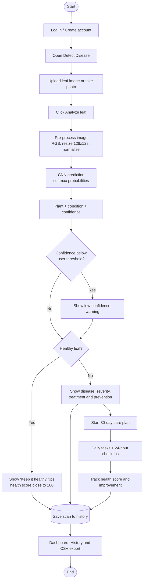

## System Architecture

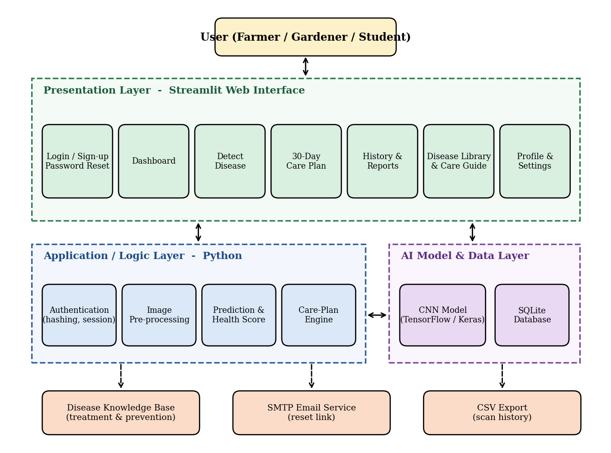

### CNN Architecture

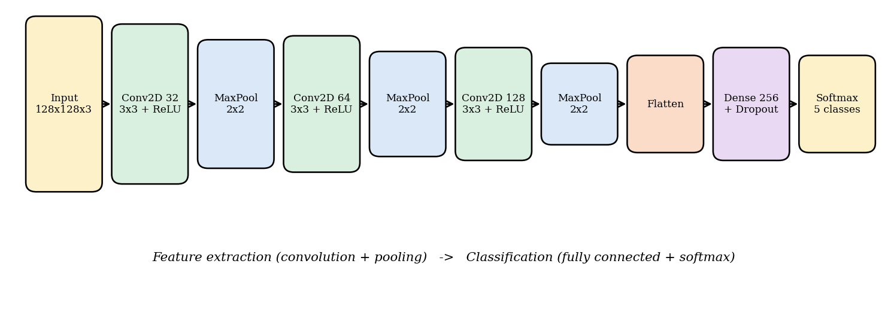

### Entity Relationship Diagram

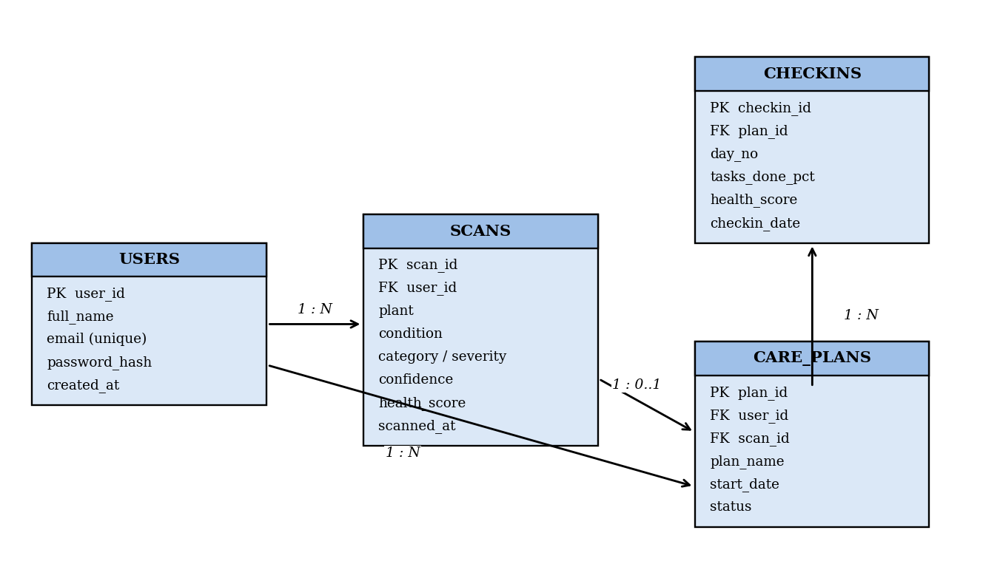

### Use Case Diagram


### Data Flow Diagram (Level 1)

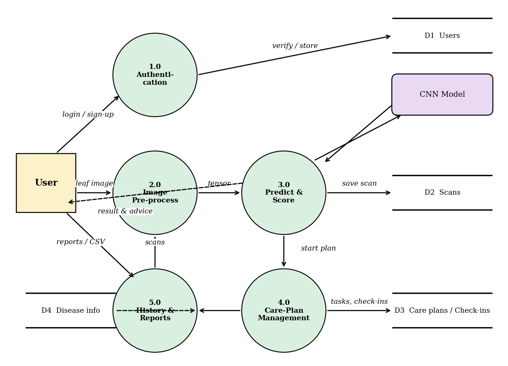

## Screenshots

### Login & Password Recovery
| Login | Forgot password |
|---|---|
| 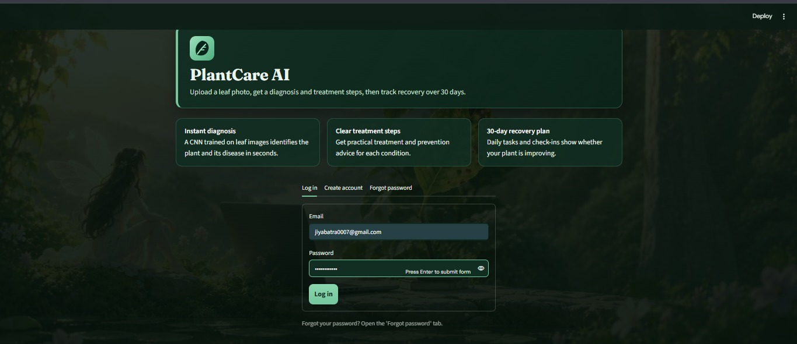 | 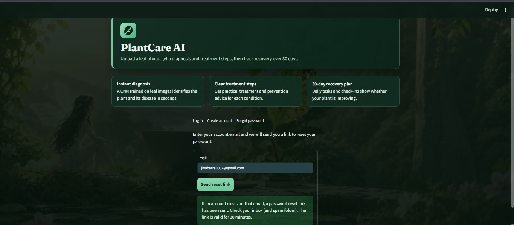 |

### Dashboard
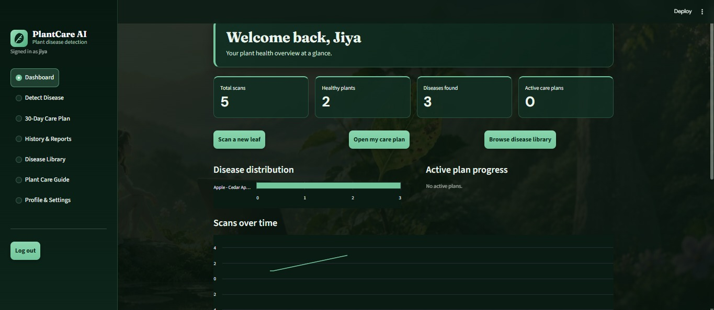

### Detect Disease
| Upload / camera | Selected leaf |
|---|---|
| 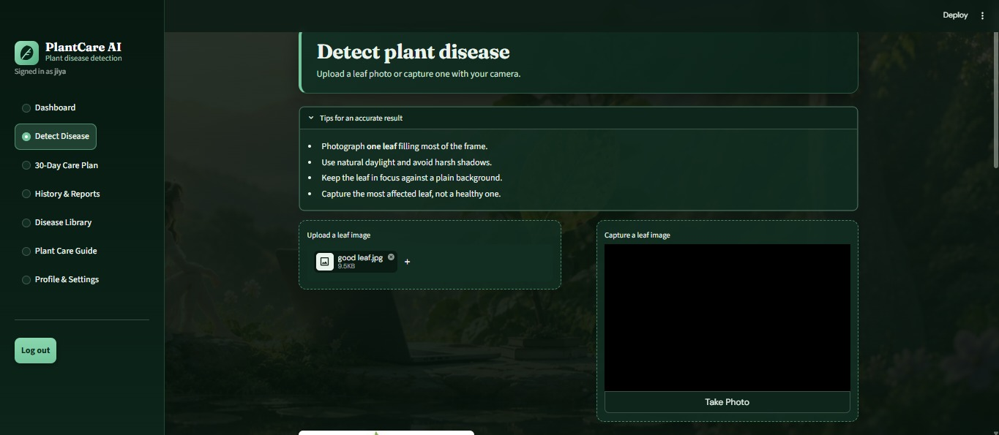 | 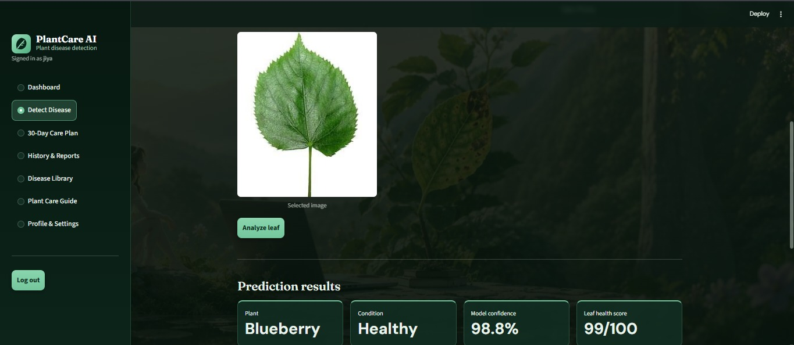 |

| Healthy result | Disease result (Cedar Apple Rust) |
|---|---|
| 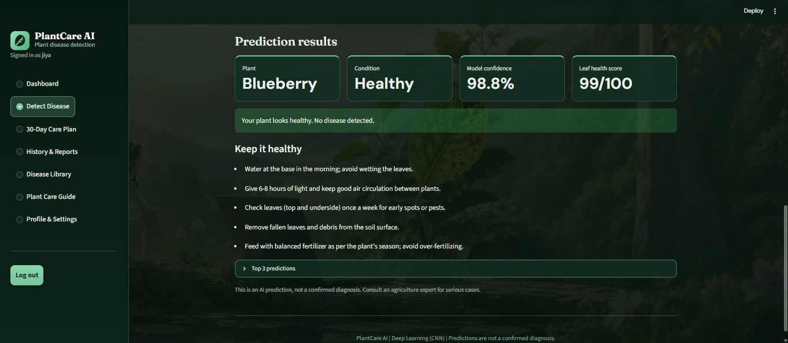 | 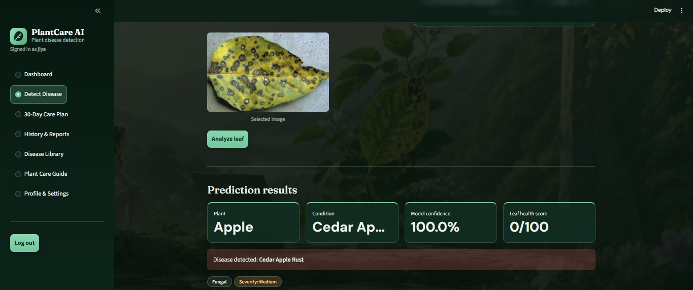 |

### Disease Library
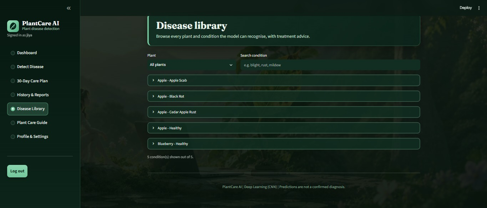

### 30-Day Care Plan
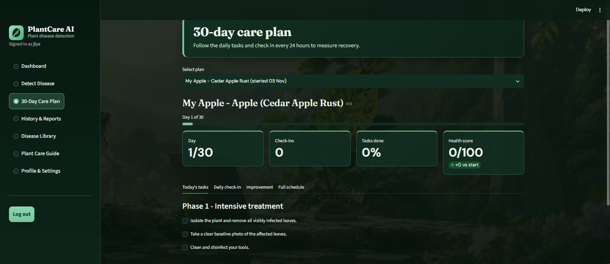

### History & Reports
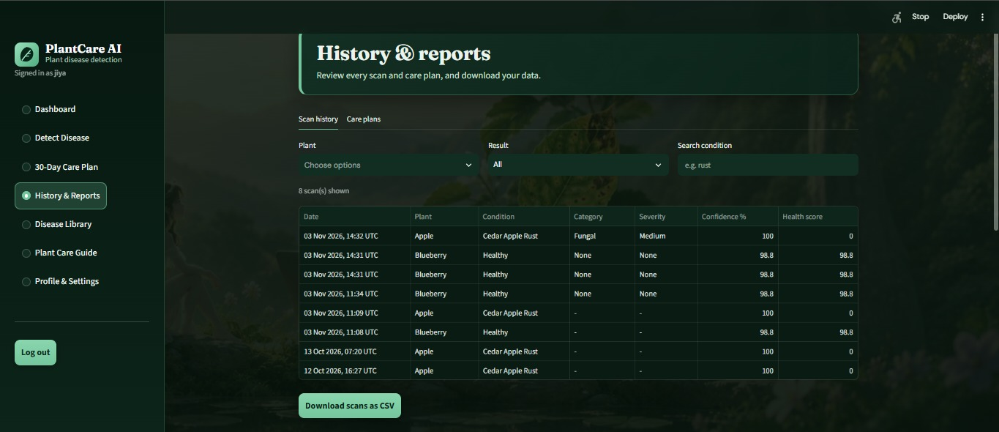

### Plant Care Guide
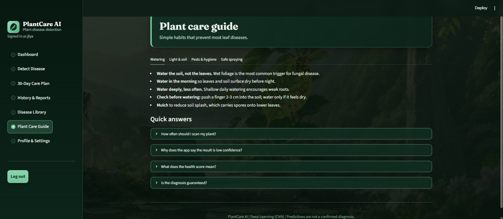

### Profile & Settings
| Account | Password |
|---|---|
| 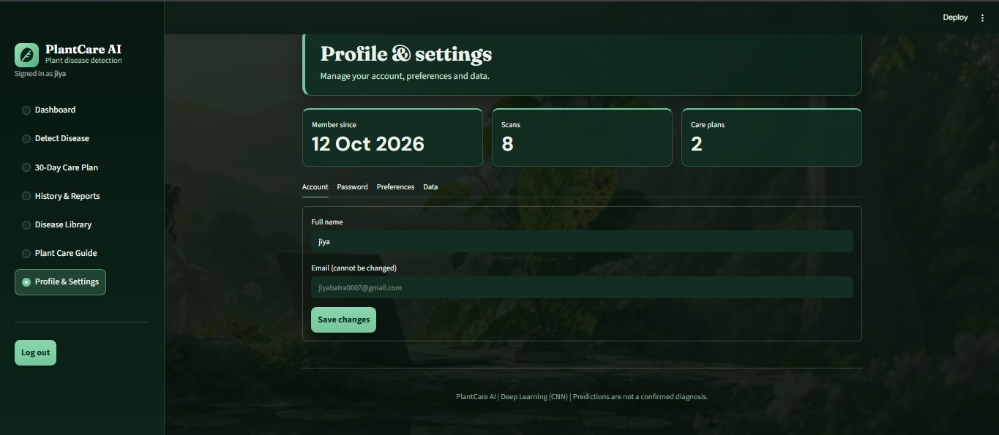 | 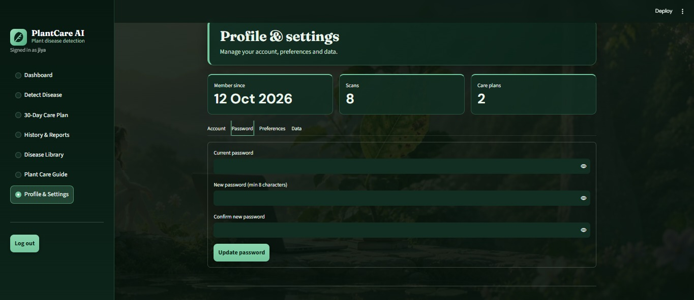 |

| Preferences | Data |
|---|---|
| 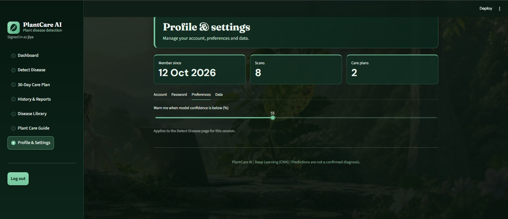 |  |

## Tech Stack

| Layer | Technology |
|---|---|
| Language | Python 3.9+ |
| Deep learning | TensorFlow / Keras (CNN) |
| Image & data | NumPy, Pillow, Pandas |
| Web UI | Streamlit |
| Database | SQLite |
| Dataset | PlantVillage |

## Getting Started

```bash
# 1. Clone the repository
git clone https://github.com/JiyaBatra/plant_diseases_detection.git
cd plant_diseases_detection

# 2. (Optional) create a virtual environment
python -m venv venv
venv\Scripts\activate        # Windows
# source venv/bin/activate   # Linux / macOS

# 3. Install dependencies
pip install -r requirements.txt

# 4. Run the app
streamlit run app.py
```

> Replace `app.py` with the name of your main Streamlit file if it is different.

Then open **http://localhost:8501** in your browser.

## Project Structure

```
plant_diseases_detection/
├── app.py                 # Streamlit application (main file)
├── model/                 # Trained CNN model
├── assets/                # Screenshots and diagrams used in this README
├── requirements.txt
└── README.md
```

> Update this tree to match your actual folders.

## Future Scope

- Train on all 38 PlantVillage classes and real field images, with an "unknown" class
- Transfer learning (MobileNetV2 / EfficientNet) and a TensorFlow Lite mobile app
- Grad-CAM heat maps to explain predictions
- Regional language support and reminder notifications

## License

This project was developed for academic purposes (B.Tech Project-I, Kurukshetra University).

---
<p align="center">PlantCare AI | Deep Learning (CNN) | Predictions are not a confirmed diagnosis</p>
